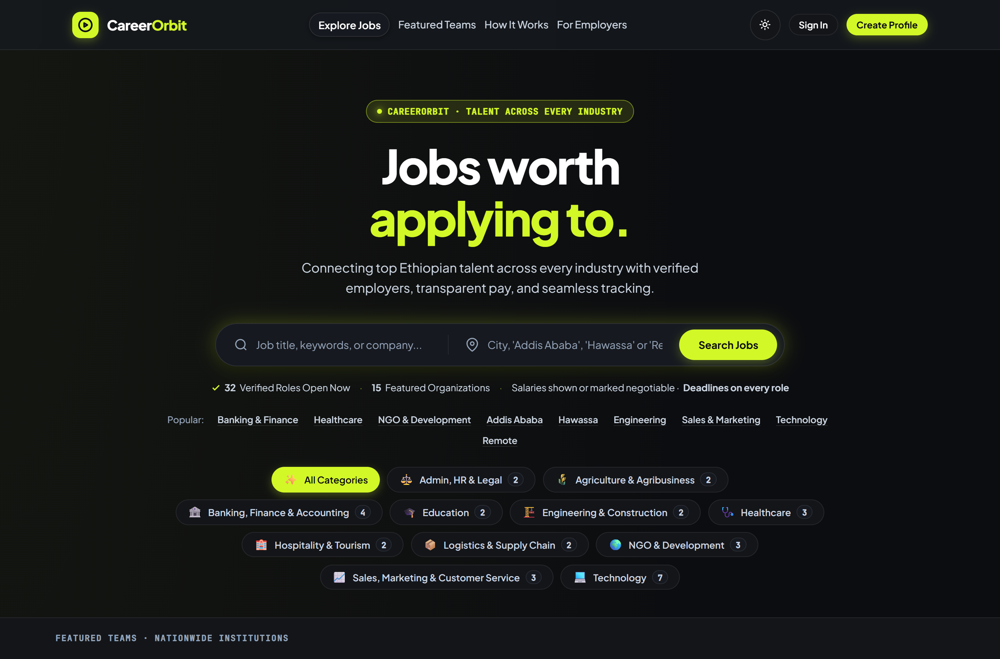
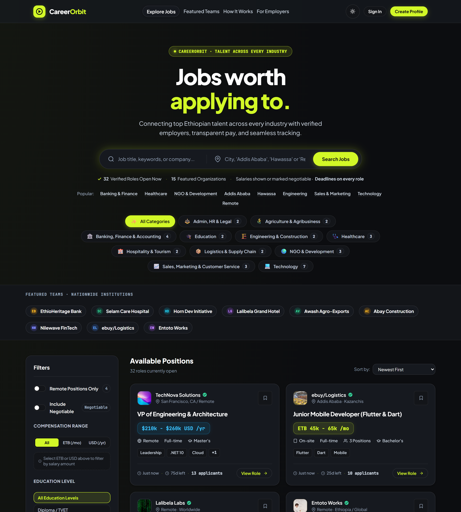
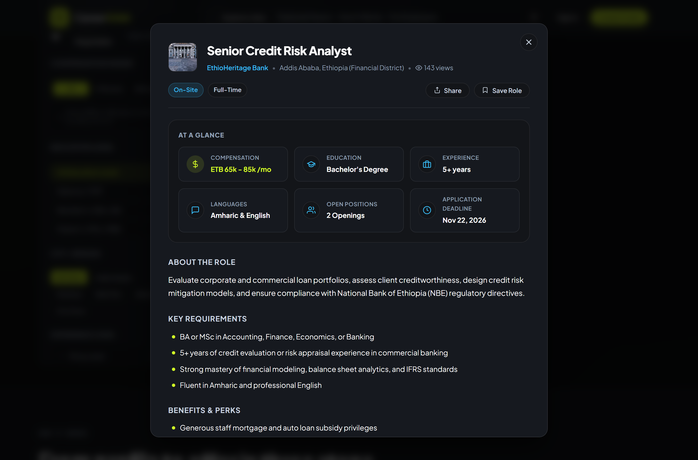
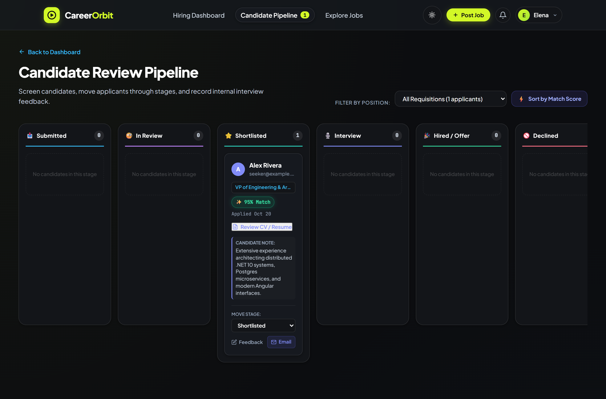
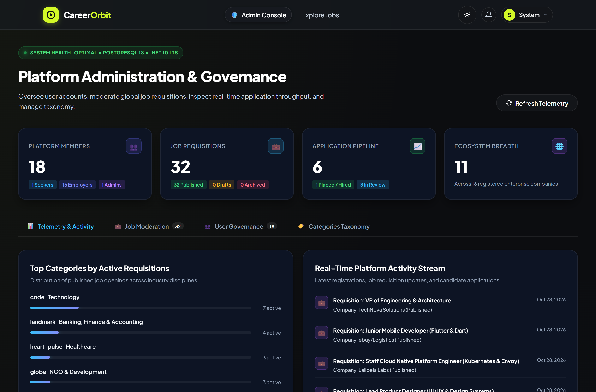
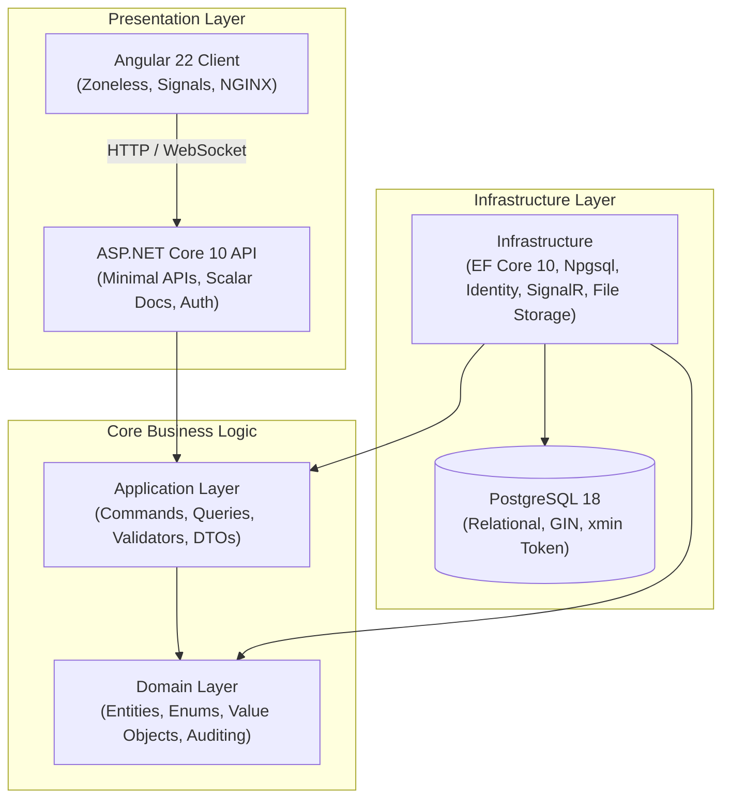

# 🚀 CareerOrbit — Enterprise Next-Gen Job Portal

[](https://dotnet.microsoft.com/)
[-DD0031?style=for-the-badge&logo=angular&logoColor=white)](https://angular.dev/)
[](https://www.postgresql.org/)
[](https://blog.cleancoder.com/)
[](http://localhost:5177/scalar/v1)
[](https://www.docker.com/)

**CareerOrbit** is a production-grade, distributed engineering career platform connecting extraordinary software engineers and tech leaders with high-conviction teams. Built on modern, bleeding-edge architectures: **ASP.NET Core 10 LTS**, **Angular 22 Zoneless Signals**, **PostgreSQL 18** with `xmin` concurrency, and real-time **SignalR** WebSockets.

---

## 📸 Platform Preview & User Interface Showcase

Experience the sleek obsidian aesthetic, modern glassmorphism, real-time reactive Angular 22 Signals, and high-conviction workflows across job seekers, employers, and administrators:

### 1. 🔍 Job Discovery, Command Search & Industry Facets
> *Real-time keystroke search with debouncing, verified active vacancy counts, and Ethiopian industry taxonomy chips.*



---

### 2. 🏛️ Nationwide Catalog & Faceted Multi-Filter Sidebar
> *Explore verified positions across nationwide institutions (`EthioHeritage Bank`, `Nilewave FinTech`, `Selam Care Hospital`, `Awash Agro-Exports`) with dual ETB/USD compensation toggles, education levels, cities, and tech skills.*



---

### 3. 📄 Interactive Role Breakdown & Ethiopian Market Compensation Modal
> *Deep-dive job modal featuring verified Ethiopian institutions (`EthioHeritage Bank`, Financial District Addis Ababa), transparent ETB salary ranges, language competencies (Amharic & English), and comprehensive role benefits.*



---

### 4. 👥 Recruiter Candidate Review Pipeline (Kanban)
> *Interactive applicant pipeline across 6 review stages (`Submitted` → `In Review` → `Shortlisted` → `Interview` → `Hired / Offer` → `Declined`) with automated AI ATS compatibility scoring (`⚡ 95% Match`), CV review, and recruiter feedback notes.*



---

### 5. 🛡️ Platform Administration & Real-Time Governance
> *Executive governance console displaying live PostgreSQL 18 & .NET 10 LTS system beacons, member breakdown metrics, active requisition analytics, and real-time activity streams.*




---

## 🏛️ System Architecture

CareerOrbit strictly implements **Clean Architecture** with inward-pointing domain dependencies, ensuring domain logic remains decoupled from frameworks, databases, and client rendering engines:



### Clean Architecture Breakdown

| Project | Responsibility | Dependencies |
|---|---|---|
| **`JobPortal.Domain`** | Enterprise business rules, domain entities (`Job`, `Company`, `JobApplication`, `JobSeekerProfile`), enums, optimistic concurrency tokens (`xmin`), and audit interfaces. | *None (Zero external dependencies)* |
| **`JobPortal.Application`** | Application business rules, CQRS commands/queries (`GetJobsQuery`, `GetJobFacetsQuery`), FluentValidation, pagination, and storage abstractions (`IFileStorageService`, `INotificationService`). | `JobPortal.Domain` |
| **`JobPortal.Infrastructure`** | Persistence (`ApplicationDbContext`), PostgreSQL 18 migrations, ASP.NET Core Identity with JWT bearer tokens, local/cloud storage, SignalR `NotificationHub`. | `JobPortal.Application`, `JobPortal.Domain` |
| **`JobPortal.Api`** | Minimal API endpoint groups (`/api/v1/jobs`, `/api/v1/employer`, `/api/v1/admin`), OpenAPI scalar specs (`/scalar/v1`), exception handling middleware, CORS policies. | `JobPortal.Infrastructure`, `JobPortal.Application` |
| **`client`** | Angular 22 Zoneless reactive client utilizing `@angular/core` signals, signal forms, cyber-dark glassmorphic design system, and floating audio-synthesized toasts. | Standalone SPA |

---

## ✨ Flagship Platform Capabilities

### 1. 🔍 Advanced Multi-Filter Search & Real-Time Faceting
- **Live Facets Engine (`GET /api/v1/jobs/facets`)**: Dynamically computes active role counts across top technical skills, 5 experience levels, job types, and published salary bounds ($75,000 to $290,000 USD).
- **Multi-Skill Tag Selector**: Multi-select pills (`.NET 10`, `Angular 22`, `Kubernetes`, `Docker`) with trending quick-chips.
- **Interactive Compensation Slider**: Dual numeric range inputs with quick-preset filters (`$80k+`, `$120k+`, `$150k+`, `$200k+`).
- **Debounced Keystroke Search**: Zero-latency search-as-you-type with 320ms debouncing.
- **Active Filters Summary Bar**: Visual breadcrumb chips with 1-click removal and "Clear All" counter badge.

### 2. 📋 Recruiter Kanban Candidate Review Pipeline
- 6-stage interactive drag-and-drop / click-to-advance pipeline (`Submitted` → `InReview` → `Shortlisted` → `Interview` → `Rejected` → `Hired`).
- Stage-change audit history with recruiter notes and timestamp tracking.
- Immediate SignalR notification dispatch on applicant state transitions.

### 3. 🔔 Real-Time SignalR Push Notifications & Audio Synthesizer
- Built-in `NotificationHub` broadcasting instant WebSocket events.
- Client-side Web Audio API chime synthesizer for audible incoming alerts.
- Top navigation notification drawer with unread counter badge and click-to-read actions.

### 4. 📄 In-App ATS Resume Inspector & Storage
- Drag-and-drop resume uploader with real-time percentage progress bar.
- Multipart form uploads with server-side MIME and 10MB size validation.
- In-app preview modal allowing recruiters to inspect CV documents directly without external downloads.

### 5. 🛡️ Admin Management & Platform Analytics
- Comprehensive telemetry metrics (Total Users, Published Roles, Active Applications, Hired Talents).
- Job moderation queue with 1-click Approve / Reject actions.
- User account security & lockout governance.
- Category taxonomy CRUD management.

---

## ⚡ Default Demo Seed Credentials

The database automatically seeds on first startup with pre-populated categories, companies, job listings, and test accounts:

| Role | Email Address | Password | Capabilities |
|---|---|---|---|
| **Platform Administrator** | `admin@jobportal.com` | `Admin@123456` | Platform metrics, moderation queue, user lockout, category CRUD |
| **Employer / Recruiter** | `employer@technova.com` | `Employer@123456` | Job creation & management, Kanban pipeline, applicant review |
| **Job Seeker** | `seeker@example.com` | `Seeker@123456` | Job search, resume upload, application tracker, saved roles |

> [!NOTE]
> Seed passwords are for local and demonstration environments only. For production deployments, change these passwords and configure custom admin accounts.

---

## 🔐 Environment Configuration & Secrets Management

CareerOrbit adheres to secure configuration standards by using placeholders in committed configuration files (`appsettings.json`) and reading actual credentials from environment variables or .NET User Secrets.

### Environment Variables Template (`.env.example`)
Copy `.env.example` to `.env` to customize settings for Docker or containerized environments:

```bash
cp .env.example .env
```

Key environment variables:
- `POSTGRES_DB`: PostgreSQL database name (default: `jobportal_db`)
- `POSTGRES_USER`: Database user (default: `postgres`)
- `POSTGRES_PASSWORD`: Database password
- `JWT_SECRET`: Minimum 32-character (256-bit) cryptographic signing key
- `JWT_ISSUER`: JWT token issuer (`JobPortalApi`)
- `JWT_AUDIENCE`: JWT token audience (`JobPortalClient`)
- `JWT_ACCESS_TOKEN_EXPIRATION_MINUTES`: Access token lifetime in minutes (default: `60`)
- `JWT_REFRESH_TOKEN_EXPIRATION_DAYS`: Refresh token lifetime in days (default: `7`)

### Local Development User Secrets (.NET)
For local development outside Docker, configure your connection string and JWT secret in the .NET User Secrets store:

```bash
dotnet user-secrets set "ConnectionStrings:DefaultConnection" "Host=localhost;Port=5432;Database=jobportal_db;Username=postgres;Password=YOUR_POSTGRES_PASSWORD" --project src/JobPortal.Api
dotnet user-secrets set "JwtSettings:Secret" "YOUR_32_CHARACTER_OR_LONGER_SECRET_KEY_HERE!" --project src/JobPortal.Api
```

---

## 🐳 Quick Start with Docker Compose

Run the entire platform (PostgreSQL 18, .NET 10 API, Angular 22 Client) with Docker Compose:

```bash
# 1. Copy environment variable template and set your secrets
cp .env.example .env

# 2. Build and launch containers
docker compose up --build
```

> [!NOTE]
> **Automated Database Setup in Docker:** When launching via Docker Compose, the backend container automatically runs `await dbContext.Database.MigrateAsync()` and seeds platform data upon startup once the PostgreSQL container passes its healthcheck. No manual `dotnet ef database update` is required inside containers.

### Exposed Services

- **Web Client (Angular 22):** [http://localhost:4200](http://localhost:4200)
- **Backend API (.NET 10):** [http://localhost:5177](http://localhost:5177)
- **Interactive Scalar API Docs:** [http://localhost:5177/scalar/v1](http://localhost:5177/scalar/v1)
- **PostgreSQL Database:** `localhost:5432`

---

## 💻 Manual Local Development Setup

### Prerequisites
- **.NET 10 SDK** (LTS)
- **EF Core CLI Tools** (install globally if needed: `dotnet tool install --global dotnet-ef`)
- **Node.js 22+ LTS** & **npm 10+**
- **PostgreSQL 18** (local service or Docker container)

### 1. Database Setup
Ensure PostgreSQL is running locally on port 5432:
```sql
CREATE DATABASE jobportal_db;
```

### 2. Backend API Configuration & Launch
Before starting the API, configure your local connection string and a random cryptographic JWT secret via .NET User Secrets (the API includes strict startup guards that prevent launching with placeholder credentials):

**Windows (PowerShell):**
```powershell
# 1. Configure local secrets
dotnet user-secrets set "ConnectionStrings:DefaultConnection" "Host=localhost;Port=5432;Database=jobportal_db;Username=postgres;Password=YOUR_POSTGRES_PASSWORD" --project src/JobPortal.Api
dotnet user-secrets set "JwtSettings:Secret" "$([Convert]::ToBase64String([System.Security.Cryptography.RandomNumberGenerator]::GetBytes(48)))" --project src/JobPortal.Api

# 2. Apply EF Core database schema
dotnet ef database update --project src/JobPortal.Infrastructure --startup-project src/JobPortal.Api

# 3. Build & Run API (Initial seed roles, categories, and sample jobs execute automatically on launch)
dotnet run --project src/JobPortal.Api --launch-profile http
```

**macOS / Linux (Bash):**
```bash
# 1. Configure local secrets
dotnet user-secrets set "ConnectionStrings:DefaultConnection" "Host=localhost;Port=5432;Database=jobportal_db;Username=postgres;Password=YOUR_POSTGRES_PASSWORD" --project src/JobPortal.Api
dotnet user-secrets set "JwtSettings:Secret" "$(openssl rand -base64 48)" --project src/JobPortal.Api

# 2. Apply EF Core database schema
dotnet ef database update --project src/JobPortal.Infrastructure --startup-project src/JobPortal.Api

# 3. Build & Run API
dotnet run --project src/JobPortal.Api --launch-profile http
```

### 3. Frontend Client
```bash
# Navigate to client directory
cd client
npm install
npm start -- --port 4200
```

---

## 🧪 Testing & API Verification

### 1. Solution Unit Tests
Execute all domain and application test suites:
```bash
dotnet test JobPortal.slnx --configuration Release
```

### 2. Interactive REST Client Verification
Use the included [`JobPortal.Api.http`](src/JobPortal.Api/JobPortal.Api.http) test suite (compatible with VS Code REST Client or Visual Studio) to test health, catalog queries, and authenticated workflows using pre-seeded test accounts:
- **Platform Health Check:** `GET /health`
- **Public Catalog & Facets:** `GET /api/v1/jobs` & `GET /api/v1/jobs/facets`
- **Job Seeker Workflow:** Authenticate as Alex Rivera, inspect application pipeline & saved jobs
- **Employer Workflow:** Authenticate as TechNova Solutions, inspect applicants & AI compatibility scores
- **Administrator Governance:** Authenticate as root admin, inspect real-time platform analytics & telemetry

---

## 📦 Tech Stack Reference

| Component | Technology | Version | Rationale |
|---|---|---|---|
| **Runtime & Framework** | ASP.NET Core on .NET | **10.0 (LTS)** | Long-term support through Nov 2028, C# 14, high-throughput Minimal APIs |
| **Relational Database** | PostgreSQL | **18** | Native JSONB, full-text search, `xmin` optimistic concurrency tokens |
| **ORM** | EF Core + Npgsql | **10.0** | High-performance PostgreSQL mapping with compiled LINQ queries |
| **Frontend Framework** | Angular | **22** | Zoneless change detection, signal-driven reactivity, standalone architecture |
| **API Documentation** | Scalar OpenAPI | **Latest** | Modern, interactive API client replacing legacy Swagger UI |
| **Real-Time Layer** | ASP.NET Core SignalR | **10.0** | Native bi-directional WebSocket push notifications |
| **Reverse Proxy** | NGINX | **1.27 Alpine** | Lean static delivery, gzip compression, SPA HTML5 routing fallback |
| **CI/CD** | GitHub Actions | **v4** | Multi-matrix automated build, unit test execution, and container check |

---

## 📄 License
This project is open-source under the [MIT License](LICENSE).
